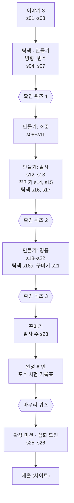

# scratch-studio

## 폴더

| 폴더 | 내용 |
| --- | --- |
| `docs/` | 커리큘럼 구성안(`scratch-curriculum-outline.md`), 기획서(`scratch-studio-spec.md`), 교안 틀(`scratch-lesson-template.md`), 본 사이트 기획서(`spec.md`), 강사용 안내서(`teacher-guides/`) |
| `styles/` | hi-fi 목업 |
| `project/` | 단원 교안. 단원 폴더에는 `unit.json`, `starter.sb3`, `media/`만 둔다 |
| `tools/` | 단원별 미리보기 GIF 생성 스크립트 |
| `app/` | 스크래치 전용 학습 화면 (목업 화면 15) |

## 문서 내려받기

본 사이트(`dlab-coding-track`)에 옮겨 쓸 문서다. 링크를 열고 GitHub 파일 화면 오른쪽 위의 다운로드 버튼(Download raw file)을 누르면 받을 수 있다. 저장소가 공개라 로그인 없이 열린다.

| 문서 | 내려받기 | 최종 수정 | 이번에 바뀐 것 |
| --- | --- | --- | --- |
| 스크래치 학생용 교안 틀 | [scratch-lesson-template.md](docs/scratch-lesson-template.md) | 2026-10-16 | 단원 흐름(이야기 1~3스텝, 개념 묶음마다 확인 퀴즈, 탐색·꾸미기 스텝, 심화 도전, 목차), 퀴즈 동작(힌트와 해설), 탐색 스텝과 입력 표, 꾸미기 스텝, 소제목, 블록 이름 코드 표기, 마크다운 범위, 채점 규칙 쓰는 법, 예시, 체크리스트 |
| 스크래치 스튜디오 기획서 | [scratch-studio-spec.md](docs/scratch-studio-spec.md) | 2026-10-16 | 5장: 미니퀴즈 동작, 소제목 표시, 목차, 입력 표. 6장: 퀴즈 문항 필드(`hint`, `explain`, `blocks`, `title`), `record` 블록과 검사, `chapters`, 마크다운 범위. 8장: 입력 표 API |
| 본 사이트 기획서 | [spec.md](docs/spec.md) | 2026-10-16 | §3.3.1: 미니퀴즈 동작, 입력 표, 목차. §5: `UNIT.chapters`, `STEP_RECORD`, `QUIZ_QUESTION.content`. §8: 학생 상세의 입력 표 열람 |
| 커리큘럼 구성안 | [scratch-curriculum-outline.md](docs/scratch-curriculum-outline.md) | 2026-10-07 | 바뀌지 않음 |
| 강사용 안내서 (해적선 대포) | [lv1-04-pirate-cannon.md](docs/teacher-guides/lv1-04-pirate-cannon.md) | 2026-10-16 | 단계 구성, 퀴즈 정답·힌트·해설 |
| 해적선 대포 교안 | [unit.json](project/lv1/04-pirate-cannon/unit.json) · [starter.sb3](project/lv1/04-pirate-cannon/starter.sb3) · [media/](project/lv1/04-pirate-cannon/media) | 2026-10-16 | 교안 틀 개정의 기준이 된 교안 |

## 학습 화면 실행

빌드 과정이 없는 정적 페이지다. 저장소 루트에서 다음을 실행하고 <http://localhost:8000/app/> 을 연다.

```
python app/serve.py
```

| 주소 옵션 | 뜻 | 기본값 |
| --- | --- | --- |
| `unit` | 단원 폴더 경로 | `../project/lv1/04-pirate-cannon` |
| `editor` | 에디터 iframe 주소 | `./editor-stub/index.html` |
| `exit` | "종료"와 "단원 목록으로"가 이동할 주소 | 이전 페이지 |
| `saveFail=1` | 첫 저장을 실패시켜 "저장 실패"와 "다시 시도"를 확인 | 끔 |

다른 단원 폴더를 열 때는 `unit`에 `unit.json`이 들어 있는 폴더를 준다. 진도는 폴더별로 따로 저장된다.

```
http://localhost:8000/app/?unit=../project/lv1/<단원 폴더>
```

## 배포 (Vercel)

교안을 보기 위한 배포다. 실제 수업용이 아니다.

주소: <https://scratch-studio-gray.vercel.app/> (`/app/`으로 연결된다)

- `main`에 푸시하면 Vercel이 자동으로 배포한다. 빌드 과정은 없다.
- `.vercelignore`로 `app/`과 `project/`만 올린다. `docs/`(강사용 안내서, 기획서), `tools/`, `styles/`는 올라가지 않는다.
- `vercel.json`: 첫 주소 `/`를 `/app/`으로 보내고, 모든 응답에 `noindex`를 붙인다.
- 배포 주소는 링크를 아는 누구나 볼 수 있다. 퀴즈 정답과 채점 규칙도 `unit.json`에 들어 있어 브라우저에서 보인다.
- 진도는 보는 사람의 브라우저에 저장된다. 서버가 없으므로 사람마다, 브라우저마다 따로 쌓인다.
- 예전 버전 1의 진도가 남은 브라우저에서 화면이 어긋나면 개발자 도구 콘솔에서 `localStorage.clear(); location.reload();`를 실행한다.

**배포 확인 (2026-10-16, 커밋 `8733afb`)**

| 확인한 것 | 결과 |
| --- | --- |
| `/`, `/app` | `/app/`으로 연결됨 |
| 학습 화면, 에디터 자리, 교안(`unit.json`, `starter.sb3`, 이미지, GIF) | 열림 |
| `docs/`, `tools/`, `styles/`, `README.md`, `app/serve.py`, `vercel.json` | 404 (배포되지 않음) |
| `X-Robots-Tag: noindex, nofollow` 헤더 | 모든 응답에 붙음 |

## 해적선 대포 교안

`project/lv1/04-pirate-cannon`. 버전 1의 내용(분량, 교안 글, 확장 미션)에 버전 2의 형식(만들기 스텝의 칸 순서, 동적 검사 우선, 미리보기 GIF)을 입혀 합친 교안이다. 2026-10-16에 이 판으로 정리하고 버전 1과 버전 2는 지웠다. 두 판은 git 이력에 남는다(버전 1: `9b59e3c`의 `project/lv1/04-pirate-cannon`, 처음 버전 2: `c572eed`).

- 교안은 `unit.json`을 직접 고친다. 합칠 때 쓴 생성 스크립트(`build_unit.py`)는 지웠다.
- `tools/04-pirate-cannon/build_media.py`는 미리보기 GIF만 다시 그린다. 다른 그림, 사진, `starter.sb3`는 건드리지 않는다.

**단원 흐름**: 32스텝 + 제출, 7개 목차



| 스텝 종류 | 스텝 | 미리보기 GIF | 채점 |
| --- | --- | --- | --- |
| 이야기 | s01~s03 | s03에 완성작 GIF | 없음 |
| 탐색 | s04 방향 눌러 보기, s07 변수 놀이터, s16 사거리 실험, s17 5도 실험, s18a 손으로 확인 | 없음 | s04, s07, s16은 입력 표의 최종 값. s16, s17은 실험 뒤 복구 확인. s18a는 없음 |
| 만들기 (13) | s05, s06, s08~s13, s18, s18b, s19, s20, s22 | 있음 | 동적 검사 우선. 정적 검사는 새 블록이 나오는 스텝에만 |
| 꾸미기 | s14 소리, s15 불꽃, s21 펑, s23 발사 수 | 없음 | 있음 (소리는 블록 검사, 나머지는 동작 확인) |
| 퀴즈 | q1, q3, q5, q6 (스텝마다 3문항) | 없음 | 모든 문항 정답 |
| 완성 확인 | s24 포수 시험 | 없음 | 게임 전체와 깃발 초기화. 기록표는 채점하지 않음 |
| 확장 미션 · 심화 | s25, s26 | 없음 | 없음 (강사 확인) |

**정한 것 (2026-10-16)**

| 항목 | 결정 |
| --- | --- |
| 만들기 스텝 | 목표 → 미리보기 GIF → 안내 → 해 보기. 목표 문장과 채점 규칙을 짝짓는다 |
| 퀴즈 | 틀리면 틀린 문항을 따로 표시하지 않고, 그 문항 아래에 노란 칸으로 힌트. 통과하면 모든 문항에 해설. 퀴즈 스텝 하나에 2~3문항. 뺀 문항은 강사용 안내서에 |
| 블록 이름 표기 | 코드 표기 (`각도를 90로 정하기`) |
| 탐색 스텝의 표 | 학생이 직접 적는 입력 표. 줄은 3개. "내 예상"(방향·위치는 보기, 각도는 숫자)을 적은 뒤 블록을 눌러 보고 "해 보니" 칸에서 [맞았어요] / [달랐어요]를 누른다. 달랐을 때만 실제 값을 고른다. 최종 값(맞았으면 예상, 달랐으면 실제)으로 채점한다 |
| 꾸미기 스텝 | 채점한다. "선택", "건너뛰어도 돼요" 문구는 뺀다. 제목은 "꾸미기: …" |
| 소제목 디자인 | 문단 맨 앞의 소제목을 아이콘 칩과 색 상자로 그린다. 목표(◎, 파랑 카드), 확인(✓, 초록), 도전(★, 주황), 해 보기(▶, 보라), 정리·되돌리기(↺, 회색), 어림해 보기·그림 보기(?, 하늘색). 코드 표기는 흰 바탕 + 테두리 |
| 목차 | 7개 목차: 이야기, 방향과 변수, 조준, 발사, 명중, 마무리, 더 해 보기 (+ 제출). 확인 퀴즈가 각 목차의 끝에 온다. 패널 위쪽에는 지금 목차 이름과 그 목차의 점만 보이고, "목차" 버튼으로 전체 목차를 연다. 통과한 스텝은 목차에서 바로 갈 수 있고, 잠긴 스텝은 자물쇠로 표시한다 |
| 스프라이트 | 대포, 포탄, 과녁. 포탄은 대포 위 레이어 |

### 교안 틀 변경 (2026-10-16 반영)

이 교안을 기준으로 교안 틀을 아래처럼 고쳤다. 기획서 5장·6장·8장과 `spec.md` §3.3.1·§5도 함께 고쳤다("문서 내려받기" 참고).

| 규칙 | 이전 교안 틀 | 바뀐 교안 틀 |
| --- | --- | --- |
| 이야기 | 1스텝, 4문장, 그림 1장 | 1~3스텝. 실제 사진은 스텝 끝에 출처 한 줄 |
| 퀴즈 개수 | 이야기 퀴즈 1개, 코드 퀴즈 1개 | 개념 묶음이 끝날 때마다 확인 퀴즈 + 마무리 퀴즈 (스텝마다 2~3문항) |
| 퀴즈 동작 | 틀려도 해설이나 틀린 문항을 보여 주지 않음 | **틀린 문항 아래에 힌트**(틀린 문항을 따로 표시하지는 않음), **통과하면 해설** |
| 스텝 종류 | 이야기, 만들기, 퀴즈 등 9종 | "탐색"(입력 표가 있으면 해 보니 칸 채점), "꾸미기"(채점), "심화 도전" 추가. 탐색·꾸미기는 `kind: lesson`이고 제목 앞의 "탐색:", "꾸미기:"로 구분 |
| 채점 규칙 | 정적, 동적, `anyOf` | 입력 표 채점 `{ "type": "record" }` 추가. 사이트가 채점한다(에디터 아님) |
| 확장 미션 | 미션마다 이름과 할 일만 | 블록 그림 단서 허용, 뒤에 심화 도전 1스텝 허용 |
| 마크다운 | 굵게와 목록만 | 표 허용, `##` 제목은 이야기와 확장 미션에만 |
| 콘텐츠 블록 | `text`, `image`, `video`, `blocks` | 입력 표 `record` 추가 (열마다 고정 글자 또는 입력 칸: 보기, 숫자, 글, 해 보니) |
| 퀴즈 문항 필드 | `key`, `question`, `options`, `answer` | `hint`, `explain` 추가. 코드 문항은 `blocks`, 그림 문항은 `image`. 퀴즈 스텝에 선택 필드 `title` |
| 스프라이트 지정 | `@first`, `@any` | 여러 스프라이트를 구분해야 하면 시작 프로젝트의 이름 |
| 정적 검사 | 블록을 꼭 써야 하는 스텝에만 | 새 블록이 나오는 스텝에만. 동적 검사로 구분되지 않을 때(시작 상태가 이미 목표와 같음, 소리처럼 동작으로 볼 수 없음)만 예외 |
| 블록 이름 | [대괄호] | 코드 표기 |
| 문장 수 | `text` 하나에 3문장 이내 | `text` 하나에 한 가지 일 |
| 소제목 | 정해진 형식 없음 | 문단 맨 앞에 `**확인**: …`처럼 "굵은 소제목 + 쌍점". 목표는 `**목표**` 다음 줄에 목록. 화면이 칩과 색 상자로 그린다 |
| 단원 목차 | 없음 | `unit.json`에 `chapters`(목차 이름과 스텝 키 목록) 추가. 화면은 목차가 있으면 목차 방식으로, 없으면 전체 점으로 보여 준다 |
| 블록 그림 | 8개 이내 | Lv.1은 전체 스크립트 그림 예외 |
| 시간 | 만들기 합계 약 75분 | 개념 묶음 전체 75분 안팎. 넘치면 탐색과 꾸미기부터 줄임 |

**탐색 스텝**: 작품에 남길 것을 만들지 않고, 블록을 눌러 보거나 숫자를 바꿔 보며 결과를 관찰하는 스텝이다. 예상하고 → 해 보고 → 결과를 비교하는 활동이 중심이고, 끝나면 꺼낸 블록을 지우거나 숫자를 원래대로 돌린다. 방향 블록 눌러 보기(s04), 변수 놀이터(s07), 사거리 실험(s16), 5도 실험(s17), 닿았는지 손으로 확인하기(s18a)가 해당한다. 이전 교안 틀은 이런 활동을 만들기 스텝 안의 "해 보기" 칸에 넣게 했는데, 바뀐 교안 틀은 따로 스텝으로 세운다.

**입력 표(`record`)**: 이 저장소의 학습 화면은 학생이 적은 값을 브라우저에 저장한다. 실제 사이트에서는 학생 × 스텝마다 `STEP_RECORD`에 저장하고(`spec.md` §5), 교사가 학생 상세 화면에서 읽는다(기획서 8장).

### 아직 정할 것

- **이야기 사진**: 출처 표기 방식과 사용 허락 범위(CC BY 3.0, 공공누리 등)
- **교안 위치**: 기획서는 `scratch-content/scratch-lv1/<단원>/`과 `tests/`, 이 저장소는 `project/lv1/<단원>/`

### 한계

- **채점 엔진이 없다.** 채점 규칙은 좌표와 시간을 계산해 맞췄을 뿐 실제로 돌려 보지 않았다. 배포된 화면의 "확인"은 에디터 자리(stub)가 고른 결과를 돌려준다. `tests/`의 정답·오답 sb3도 없다.
- **그림 속 글자가 한국어로만 되어 있다**(GIF의 "각도", "명중" 등).
- **공개 범위**: 배포 주소와 GitHub 저장소 모두 누구나 열 수 있다. 퀴즈 정답과 채점 규칙은 `unit.json`에, 정답과 해설은 강사용 안내서(`docs/teacher-guides/`)에 들어 있어 누구나 볼 수 있다. `.vercelignore`는 배포 주소에서만 `docs/`를 감춘다.

## 아직 실제가 아닌 부분

- **에디터**: `app/editor-stub/`은 메시지 규약(기획서 4장)만 흉내 내는 자리다. 채점은 하지 않고 화면에서 고른 결과(통과, 실패, 오류, 응답 없음)를 돌려준다. 실제 에디터가 준비되면 `editor` 주소만 바꾼다.
- **서버**: `app/store.js`가 본 사이트의 API(기획서 8장)를 대신해 진도와 제출을 브라우저에 저장한다. 채점 규칙(`checks`)도 브라우저로 내려오므로 실제 사이트에서는 이 파일을 서버 호출로 바꿔야 한다.
- **미니퀴즈**: `unit.json`의 퀴즈 스텝을 그린다. 기획서 형식(`"kind": "quiz"`)과 이전 형식(`"type": "quiz"`)을 모두 읽는다. 모든 문항이 정답이어야 통과이고 다시 풀 수 있다. 정답이 브라우저로 내려오므로 실제 사이트에서는 서버가 판정해야 한다.
- **건너뛰기 (교안 확인용, 임시)**: 채점이 있는 스텝 아래에 "건너뛰기 (교안 확인용)"이 있다. 누르면 채점 없이 통과 처리하고 다음 스텝으로 간다. 실제 수업용으로 쓸 때는 `app/dev-skip.js`, `app/main.js`에서 `dev-skip`으로 검색되는 줄, `app/store.js`의 `devPass`, `app/styles.css`의 `.ss-dev-skip` 스타일을 지운다.
- **프로젝트 제출**: 사이트가 배치하는 기능이라 단원 끝에 제출 스텝을 붙인다.
