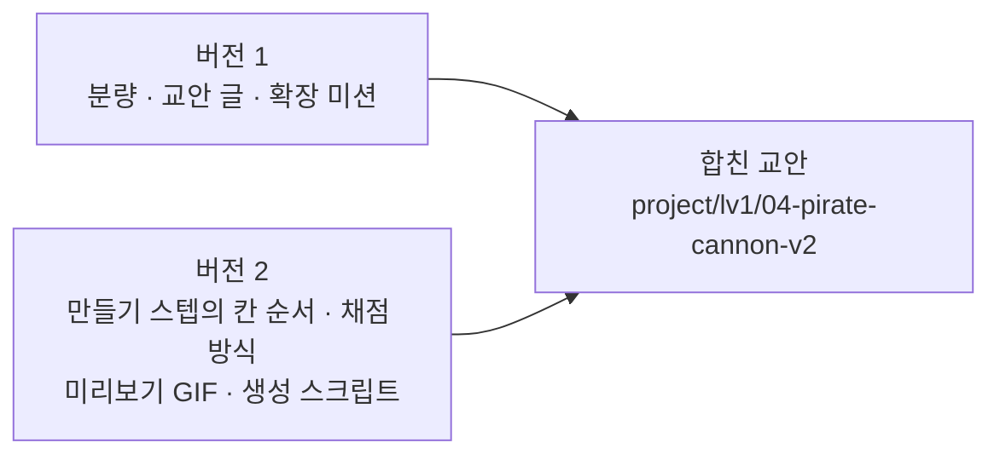
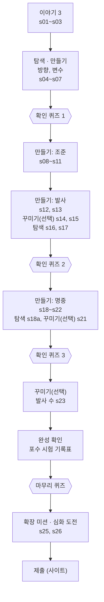
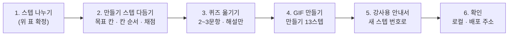

# scratch-studio

## 폴더

| 폴더 | 내용 |
| --- | --- |
| `docs/` | 커리큘럼 구성안(`scratch-curriculum-outline.md`), 기획서(`scratch-studio-spec.md`), 교안 틀(`scratch-lesson-template.md`), 본 사이트 기획서(`spec.md`), 강사용 안내서(`teacher-guides/`) |
| `styles/` | hi-fi 목업 |
| `project/` | 단원 교안. 단원 폴더에는 `unit.json`, `starter.sb3`, `media/`만 둔다 |
| `tools/` | 단원별 교안 생성 스크립트 |
| `app/` | 스크래치 전용 학습 화면 (목업 화면 15) |

## 학습 화면 실행

빌드 과정이 없는 정적 페이지다. 저장소 루트에서 다음을 실행하고 <http://localhost:8000/app/> 을 연다.

```
python app/serve.py
```

| 주소 옵션 | 뜻 | 기본값 |
| --- | --- | --- |
| `unit` | 단원 폴더 경로 | `../project/lv1/04-pirate-cannon` |
| `editor` | 에디터 iframe 주소 | `./editor-stub/index.html` |
| `exit` | "종료"와 "단원 목록으로"가 이동할 주소 | 이전 페이지 |
| `saveFail=1` | 첫 저장을 실패시켜 "저장 실패"와 "다시 시도"를 확인 | 끔 |

다른 단원 폴더를 열 때는 `unit`에 `unit.json`이 들어 있는 폴더를 준다. 진도는 폴더별로 따로 저장된다.

```
http://localhost:8000/app/?unit=../project/lv1/<단원 폴더>
```

## 배포 (Vercel)

교안을 보기 위한 배포다. 실제 수업용이 아니다.

주소: <https://scratch-studio-gray.vercel.app/> (`/app/`으로 연결된다)

- `main`에 푸시하면 Vercel이 자동으로 배포한다. 빌드 과정은 없다.
- `.vercelignore`로 `app/`과 `project/`만 올린다. `docs/`(강사용 안내서, 기획서), `tools/`, `styles/`는 올라가지 않는다.
- `vercel.json`: 첫 주소 `/`를 `/app/`으로 보내고, 모든 응답에 `noindex`를 붙인다.
- 배포 주소는 링크를 아는 누구나 볼 수 있다. 퀴즈 정답과 채점 규칙도 `unit.json`에 들어 있어 브라우저에서 보인다.
- 진도는 보는 사람의 브라우저에 저장된다. 서버가 없으므로 사람마다, 브라우저마다 따로 쌓인다.

**배포 확인 (2026-10-16, 커밋 `8733afb`)**

| 확인한 것 | 결과 |
| --- | --- |
| `/`, `/app` | `/app/`으로 연결됨 |
| 학습 화면, 에디터 자리, 교안(`unit.json`, `starter.sb3`, 이미지, GIF) | 열림 |
| `docs/`, `tools/`, `styles/`, `README.md`, `app/serve.py`, `vercel.json` | 404 (배포되지 않음) |
| `X-Robots-Tag: noindex, nofollow` 헤더 | 모든 응답에 붙음 |
| 버전 1 (32스텝 + 제출) | 처음부터 끝까지 넘김. 블록 그림, 이미지, 퀴즈 정상 |
| 버전 2 (18스텝 + 제출) | 처음부터 끝까지 넘김. 블록 그림, 이미지, GIF, 퀴즈 정상 |

## 해적선 대포 버전 1, 2 보기 (임시)

> 두 버전을 합쳐 한 판으로 확정하면 지울 절이다.

### 보는 곳

| 버전 | 폴더 | 주소 |
| --- | --- | --- |
| 1 | `project/lv1/04-pirate-cannon` | <https://scratch-studio-gray.vercel.app/app/> |
| 2 | `project/lv1/04-pirate-cannon-v2` | <https://scratch-studio-gray.vercel.app/app/?unit=../project/lv1/04-pirate-cannon-v2> |

진도는 폴더별로 따로 저장된다.

### 두 버전의 차이

| 항목 | 버전 1 | 버전 2 |
| --- | --- | --- |
| 기준 | 교안 틀 이전에 쓴 교안 | 「스크래치 학생용 교안 틀」(`docs/scratch-lesson-template.md`) |
| 스텝 수 | 32 | 18 (이야기 1, 이야기 퀴즈 1, 오늘 만들 것 1, 만들기 12, 코드 퀴즈 1, 완성 확인 1, 확장 미션 1) |
| 퀴즈 | 퀴즈 스텝 4개, 16문항. 힌트와 해설 있음 | 이야기 퀴즈 2문항, 코드 퀴즈 5문항. 힌트와 해설 없음 |
| 퀴즈 형식 | `"type": "quiz"`, 문항에 `id`, `prompt`, `hint`, `explain` | 기획서 6장의 `"kind": "quiz"`, 문항에 `key`, `question` (코드 퀴즈만 `blocks` 추가) |
| 만들기 스텝 | 스텝마다 구성이 다름 | 제목 → 목표 → 미리보기 GIF → 안내 → 해 보기 |
| 교안 문장 | 표와 `##` 제목 사용. 이야기에 사진과 출처 | 굵게와 목록만. 이야기는 4문장과 그림 1장 |
| 미리보기 | 없음 | 만들기 스텝마다 GIF (`tools/04-pirate-cannon-v2/build_media.py`로 생성) |
| 실험, 포수 시험 | 따로 스텝 | 작품에 남지 않는 활동이라 "해 보기"에 넣음 |
| 소리, 불꽃, 펑, 발사 수 | 선택 스텝(꾸미기, 발사 수 세기) | 확장 미션 |
| 강사용 안내서 | `docs/teacher-guides/lv1-04-pirate-cannon.md` | 없음 |

### 합치기 계획

버전 1의 내용에 버전 2의 형식을 입혀, 버전 2 폴더를 합친 교안으로 다시 쓴다. 지금의 버전 2는 git 이력(`c572eed`)에 남는다.



**정한 것 (2026-10-16)**

| 항목 | 결정 |
| --- | --- |
| 교안 틀 | 직접 고치지 않는다. 아래 "교안 틀 변경 계획"을 따로 둔다 |
| 퀴즈 | 틀리면 통과/실패만 알린다(어느 문항이 틀렸는지, 힌트 없음). 통과하면 문항마다 해설 |
| 확인 퀴즈 문항 수 | 퀴즈 스텝 하나에 2~3문항 |
| 블록 이름 표기 | 코드 표기 (`각도를 90로 정하기`) |
| 완성 확인 | 넣는다. 버전 1의 포수 시험 자리에 두고 기록표를 살린다 |
| 미리보기 GIF | 만들기 스텝에만 |
| 작업 위치 | 버전 2 폴더를 고친다 |

**합친 교안의 단원 흐름 (안)**: 버전 1의 32스텝을 스텝 종류로 나눈 것이다. 확정은 진행 순서 1에서 한다.



| 스텝 종류 | 버전 1 스텝 | 미리보기 GIF | 채점 |
| --- | --- | --- | --- |
| 이야기 | s01~s03 | 없음 | 없음 |
| 탐색 | s04 방향 눌러 보기, s07 변수 놀이터, s16 사거리 실험, s17 5도 실험, s18a 손으로 확인 | 없음 | 없음 (s16, s17은 복구 확인만) |
| 만들기 (13) | s05, s06, s08~s13, s18, s18b, s19, s20, s22 | 있음 | 동적 검사 우선 |
| 꾸미기(선택) | s14 소리, s15 불꽃, s21 펑, s23 발사 수 | 없음 | 없음 |
| 퀴즈 | q1, q3, q5, q6 (16문항에서 스텝마다 2~3문항으로 추림, 해설 포함) | 없음 | 모든 문항 정답 |
| 완성 확인 | s24 포수 시험 자리 | 없음 | 게임 전체와 초기화 |
| 확장 미션 · 심화 | s25, s26 | 없음 | 없음 (강사 확인) |

**진행 순서**



| 단계 | 할 일 | 상태 |
| --- | --- | --- |
| 1 | 버전 1의 32스텝을 이야기·탐색·만들기·꾸미기·퀴즈로 나누고, 완성 확인 스텝을 더한다 | 대기 |
| 2 | 버전 1의 글은 그대로 두고, 만들기 스텝 맨 위에 목표를 세워 목표 → GIF → 안내 → 해 보기 순서로 재배치한다. 목표 문장과 채점 규칙을 짝짓고, 말풍선 채점의 한국어·영어 값 버그를 고친다 | 대기 |
| 3 | 퀴즈를 스텝마다 2~3문항으로 추려 `"kind": "quiz"`, `key`, `question` 형식으로 옮긴다. 해설은 남기고 힌트는 뺀다(뺀 문항과 힌트는 강사용 안내서로). 화면에서 틀린 문항 표시와 힌트 표시를 없앤다 | 대기 |
| 4 | 만들기 13스텝의 GIF를 만든다. "각도 말하기", "닿으면 '명중!' 말하기"는 새로 만든다 | 대기 |
| 5 | 강사용 안내서를 새 스텝 번호에 맞춰 고쳐 붙인다 | 대기 |
| 6 | 로컬과 배포 주소에서 처음부터 끝까지 넘겨 보고, 이 절을 갱신한다 | 대기 |

### 교안 틀 변경 계획 (교안 틀은 아직 고치지 않음)

합친 교안이 교안 틀과 어긋나는 곳과, 교안 틀을 고친다면 바꿀 내용이다.

| 규칙 | 지금 교안 틀 | 바꿀 안 |
| --- | --- | --- |
| 이야기 | 1스텝, 4문장, 그림 1장 | 1~3스텝. 실제 사진은 스텝 끝에 출처 한 줄 |
| 퀴즈 개수 | 이야기 퀴즈 1개, 코드 퀴즈 1개 | 개념 묶음이 끝날 때마다 확인 퀴즈 (단원당 3~4개, 스텝마다 2~3문항) |
| 퀴즈 동작 | 틀려도 해설이나 틀린 문항을 보여 주지 않음 | 틀렸을 때는 그대로(통과/실패만). **통과하면 해설을 보여 준다** |
| 스텝 종류 | 이야기, 만들기, 퀴즈 등 9종 | "탐색"(채점 없음), "꾸미기(선택)"(채점 없음) 추가 |
| 확장 미션 | 미션마다 이름과 할 일만 | 블록 그림 단서 허용, 뒤에 심화 도전 1스텝 허용 |
| 마크다운 | 굵게와 목록만 | 표 허용, `##` 제목은 이야기와 확장 미션에만 |
| 블록 이름 | [대괄호] | 코드 표기 |
| 문장 수 | `text` 하나에 3문장 이내 | `text` 하나에 한 가지 일 |
| 블록 그림 | 8개 이내 | Lv.1은 전체 스크립트 그림 예외 |
| 시간 | 만들기 합계 약 75분 | 이야기부터 확장 미션까지 전체 시간으로 |

**탐색 스텝**: 작품에 남길 것을 만들지 않고, 블록을 눌러 보거나 숫자를 바꿔 보며 결과를 관찰하는 스텝이다. 예상하고 → 해 보고 → 결과를 비교하는 활동이 중심이고, 끝나면 꺼낸 블록을 지우거나 숫자를 원래대로 돌린다. 버전 1의 방향 블록 눌러 보기(s04), 변수 놀이터(s07), 사거리 실험(s16), 5도 실험(s17), 닿았는지 손으로 확인하기(s18a)가 해당한다. 교안 틀은 이런 활동을 만들기 스텝 안의 "해 보기" 칸에 넣게 하는데, 이 계획은 따로 스텝으로 세운다.

교안 틀을 고칠 때는 기획서 5장·6장과 `spec.md` §3.3.1(퀴즈 동작, 스텝 종류, 마크다운 범위)도 함께 고친다.

### 아직 정할 것

- **코드 퀴즈의 `blocks` 필드**: 기획서 6장의 문항 필드에 넣을지
- **퀴즈 스텝 제목**: 기획서 형식에는 제목이 없어 화면에 "퀴즈"로만 나온다. 제목 필드를 둘지
- **스프라이트 지정**: 교안 틀은 `@first`, `@any`를 쓰라고 하지만 스프라이트가 셋이라 이름으로 가리킨다. 예외로 적을지
- **이야기 사진**: 출처 표기 방식과 사용 허락 범위(CC BY 3.0, 공공누리 등)
- **`unitKey`**: 두 판이 같은 `04-pirate-cannon`이라 가져오기 스크립트로는 한쪽만 들어간다. 합친 뒤 하나로 정리
- **교안 위치**: 기획서는 `scratch-content/scratch-lv1/<단원>/`과 `tests/`, 이 저장소는 `project/lv1/<단원>/`

### 한계

- **채점 엔진이 없다.** 채점 규칙은 좌표와 시간을 계산해 맞췄을 뿐 실제로 돌려 보지 않았다. 배포된 화면의 "확인"은 에디터 자리(stub)가 고른 결과를 돌려준다. `tests/`의 정답·오답 sb3도 없다.
- **영어 진행 시 채점 버그**: 버전 1 s18b("명중")와 버전 2 s14("승리")가 말풍선의 한국어만 찾는다. 합치면서 `{ "ko", "en" }` 값으로 고친다.
- **그림 속 글자가 한국어로만 되어 있다**(GIF의 "각도", "명중" 등).
- **버전 1의 생성 스크립트**(`tools/04-pirate-cannon/`)는 예전 판 기준이라, 다시 돌리면 지금 교안이 덮어써진다.
- **강사용 안내서의 스텝 표**에는 s23이 "자동 검사 있음"으로 되어 있지만 교안의 s23에는 검사가 없다.
- **공개 범위**: 배포 주소는 누구나 열 수 있고, 퀴즈 정답과 채점 규칙이 `unit.json`에 들어 있어 브라우저에서 보인다.

## 아직 실제가 아닌 부분

- **에디터**: `app/editor-stub/`은 메시지 규약(기획서 4장)만 흉내 내는 자리다. 채점은 하지 않고 화면에서 고른 결과(통과, 실패, 오류, 응답 없음)를 돌려준다. 실제 에디터가 준비되면 `editor` 주소만 바꾼다.
- **서버**: `app/store.js`가 본 사이트의 API(기획서 8장)를 대신해 진도와 제출을 브라우저에 저장한다. 채점 규칙(`checks`)도 브라우저로 내려오므로 실제 사이트에서는 이 파일을 서버 호출로 바꿔야 한다.
- **미니퀴즈**: `unit.json`의 퀴즈 스텝을 그린다. 기획서 형식(`"kind": "quiz"`)과 이전 형식(`"type": "quiz"`)을 모두 읽는다. 모든 문항이 정답이어야 통과이고 다시 풀 수 있다. 정답이 브라우저로 내려오므로 실제 사이트에서는 서버가 판정해야 한다.
- **프로젝트 제출**: 사이트가 배치하는 기능이라 단원 끝에 제출 스텝을 붙인다.
